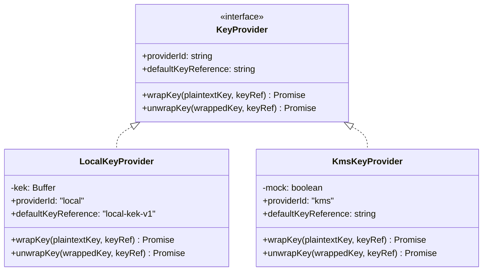

# Phase P19 Design Note: AES-256-GCM Envelope Encryption & Key Management

## 1. Executive Summary & Scope

Phase P19 establishes the cryptographic foundation for the Secure Upload Gateway (SUG) in `packages/crypto`.
The component implements application-level envelope encryption using **AES-256-GCM** for payload encryption and **AES-256 Key Wrap (RFC 3394)** for Data Encryption Key (DEK) protection.

All clean objects promoted to storage are encapsulated in the canonical binary **`SUG1`** envelope format (ADR-0010, DEC-012).

### Boundaries & Constraints:

- **In Scope (P19)**:
  - `packages/crypto` public API and core primitives.
  - `SUG1` binary envelope format serializer and parser.
  - Per-file fresh 256-bit DEK generation.
  - Per-encryption fresh 96-bit (12-byte) CSPRNG nonce generation.
  - Authenticated Additional Data (AAD) binding to immutable artifact identity.
  - `KeyProvider` interface with `LocalKeyProvider` (Docker secrets / environment) and `KmsKeyProvider` (interface/stub).
  - Verify-before-release decryption with strict authentication tag validation.
  - DoD test suites: `crypto-01` through `crypto-04`.
  - Stored test vectors in `packages/crypto/test-vectors/sug1-vectors.json`.
  - Nonce-uniqueness empirical test over 10,000 encryptions.
- **Out of Scope (Deferred to P20+)**:
  - Promotion service (`services/promotion`).
  - Quarantine-to-clean storage migration loop.
  - Download endpoints / HTTP controllers (`GET /files/:id`).
  - Database persistence of promoted cloud objects.

---

## 2. Cryptographic Specifications

### 2.1 Cipher & Parameters

- **Data Encryption Algorithm**: AES-256-GCM (NIST SP 800-38D).
- **Data Encryption Key (DEK)**: 256 bits (32 bytes), generated via `node:crypto.randomBytes(32)` for every encryption operation.
- **Initialization Vector / Nonce**: 96 bits (12 bytes), generated via `node:crypto.randomBytes(12)` for every encryption operation. Nonces are NEVER reused with the same key.
- **Authentication Tag**: 128 bits (16 bytes), generated by AES-GCM and verified before releasing plaintext.
- **Key Wrapping Algorithm**: AES-256 Key Wrap (RFC 3394, `id-aes256-wrap` / NIST SP 800-38F) using default ICV `0xA6A6A6A6A6A6A6A6`.
  - 32-byte DEK wraps to a 40-byte wrapped key blob (32 bytes key + 8 bytes integrity check value).
- **Master Key Encryption Key (KEK)**: 256 bits (32 bytes), loaded via `LocalKeyProvider` from Docker file secret `/run/secrets/kek` or `SUG_KEK` environment variable.

---

## 3. SUG1 Binary Envelope Wire Format

The serialized envelope format conforms strictly to ADR-0010 Section 1:

```
+---------------------------------------------------------------------------------+
| Offset | Field               | Size (Bytes) | Description                       |
+--------+---------------------+--------------+-----------------------------------+
| 0..3   | Magic               | 4            | ASCII "SUG1" (0x53,0x55,0x47,0x31)|
| 4      | Version             | 1            | uint8 (0x01)                      |
| 5..16  | IV / Nonce          | 12           | 96-bit CSPRNG Nonce               |
| 17..18 | Wrapped DEK Length  | 2            | uint16BE (e.g. 0x0028 = 40 bytes) |
| 19..58 | Wrapped DEK         | variable (40)| RFC 3394 wrapped DEK              |
| 59..74 | Authentication Tag  | 16           | 128-bit AES-GCM Tag               |
| 75..N  | Ciphertext          | N - 75       | AES-256-GCM encrypted payload     |
+---------------------------------------------------------------------------------+
```

### Parsing Rules & Constraints:

- Minimum valid envelope size: `4 + 1 + 12 + 2 + 0 + 16 = 35` bytes.
- Standard envelope header size with 40-byte wrapped DEK: `75` bytes.
- Header validation is fail-closed:
  - If magic != `'SUG1'`, rejects with `InvalidMagicError`.
  - If version != `1`, rejects with `UnsupportedVersionError`.
  - If buffer is truncated or smaller than header bounds, rejects with `InvalidEnvelopeError`.

---

## 4. Authenticated Additional Data (AAD) Binding

To prevent cross-artifact ciphertext substitution or tampering, the AES-GCM cipher authenticates canonical file identity metadata.

### Bound Fields (ADR-0010 §1):

1. `app_id`: Application UUID (string).
2. `file_id`: File UUID (string).
3. `storage_version_id`: Immutable storage version identifier (string).
4. `sha256_plaintext`: Lowercase 64-character hexadecimal SHA-256 digest of original plaintext.

### Canonical Length-Prefixed Encoding:

To guarantee unambiguous delimiter-free parsing and prevent collision attacks, AAD is encoded using big-endian 32-bit length prefixes:

```
[uint32BE(len("SUG-AAD-V1"))][ "SUG-AAD-V1" ]
[uint32BE(len(appId))       ][ appId         ]
[uint32BE(len(fileId))      ][ fileId        ]
[uint32BE(len(storageVer))  ][ storageVer    ]
[uint32BE(len(sha256))      ][ sha256        ]
```

If ANY field is altered between encryption and decryption, AES-GCM authentication fails immediately during `decipher.final()`.

---

## 5. Key Provider Architecture



1. **`LocalKeyProvider`**:
   - Reads 256-bit KEK from file (Docker secret `/run/secrets/kek`) or `SUG_KEK` / `KEK`.
   - Validates that KEK is exactly 32 bytes (64 hex chars or 32-byte base64).
   - Fails closed if KEK is missing, corrupt, or inaccessible.
   - Uses RFC 3394 AES-256 Key Wrap.
2. **`KmsKeyProvider`**:
   - Implements `KeyProvider` contract as a P19 stub.
   - Provides a `mock` mode for hermetic unit testing without cloud charges or credentials.
   - In production mode, safely fails closed until Phase P24+ live cloud deployment.

---

## 6. Verify-Before-Release Decryption

AES-GCM authentication tags are verified at the completion of decryption:

1. `decipher.setAuthTag(header.authTag)` and `decipher.setAAD(canonicalAad)`.
2. Plaintext is decrypted into memory buffers.
3. `decipher.final()` is invoked to verify the GMAC tag.
4. **Invariant**: Plaintext is returned to the caller ONLY IF `decipher.final()` succeeds.
5. If authentication fails, the error is caught, temporary plaintext buffers are discarded, DEK is zeroed, and `AuthenticationError` is thrown. Zero partial plaintext is released.

---

## 7. Mandatory Test Matrix (DoD: crypto-01 to crypto-04)

| DoD ID               | Test Name                                       | Key Verification Target                                                                                                                                                                                            |
| :------------------- | :---------------------------------------------- | :----------------------------------------------------------------------------------------------------------------------------------------------------------------------------------------------------------------- |
| **`crypto-01`**      | **Envelope Encryption & Round-Trip Decryption** | AES-256-GCM + RFC 3394 KeyWrap generates valid `SUG1` envelope. Correctly round-trips plaintext. Fresh DEK/nonce per run.                                                                                          |
| **`crypto-02`**      | **Verify-Before-Release & Tamper Rejection**    | Modifying ciphertext or auth tag fails authentication. Truncated or malformed headers fail closed. Zero unauthenticated plaintext released.                                                                        |
| **`crypto-03`**      | **AAD Identity Binding**                        | Ciphertext strictly bound to `(appId, fileId, storageVersionId, sha256Plaintext)`. Altering any metadata field throws `AuthenticationError`.                                                                       |
| **`crypto-04`**      | **Key Management & Fail-Closed Providers**      | `LocalKeyProvider` loads KEK safely. Rejects invalid KEK lengths. Unwrapping with wrong KEK or wrong key reference fails closed. `KmsKeyProvider` stub contract verified. Plaintext DEK never logged or persisted. |
| **Nonce Uniqueness** | **10,000-Iteration Empirical Nonce Check**      | 10,000 consecutive encryptions using production generator produces 10,000 distinct nonces (0 collisions).                                                                                                          |
| **Test Vectors**     | **Cryptographic Test Vectors Validation**       | Positive and negative test vectors validated against `sug1-vectors.json`.                                                                                                                                          |
